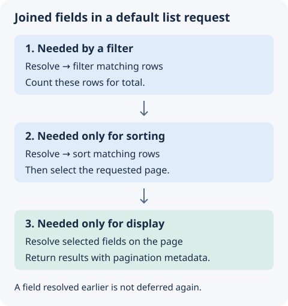

## Overview

The `@Joined` decorator copies one scalar field from another table onto each row at query time. `@Foreign` nests the whole referenced record under the field. `@Joined` puts one remote field at the top level of the row, before the list query sorts and filters. The database can therefore sort, filter, and search on the joined field.

Joined fields are read-only. A lookup sets the value at query time, and the controller's own table never stores it. Declaring a field as joined sets its access mode to read-only and makes its sort non-indexed.

## Basic usage

Apply `@Joined` to a field that takes its value from a remote table. The local row must hold a key (`localKey`) that matches the remote table's `remoteIndex`.

Use [foreign keys](./7.foreign-keys.md) when the response needs a nested record instead. The snippets below assume the controller imports and the model from the [quick start](./1.introduction.md#quick-start), with `myapp` registered before the module serves requests.

```typescript fragment
import { Joined } from "@antelopejs/interface-data-api/metadata";
import {
  Field,
  RegisterTable,
  Relation,
  Table,
} from "@antelopejs/interface-database-decorators";

@RegisterTable("users", "myapp")
class User extends Table {
  @Field("string")
  declare _id: string;

  @Field("string")
  declare name: string;
}

@RegisterTable("orders", "myapp")
class Order extends Table {
  @Field("string")
  declare _id: string;

  @Field("string")
  @Relation({ to: () => User })
  declare userId: string;

  @Field("number")
  declare total: number;
}

@RegisterDataController()
class OrderAPI extends DataController(
  Order,
  DefaultRoutes.All,
  Controller("/orders"),
) {
  @ModelReference()
  @Model(OrderModel, "my-database")
  declare orderModel: OrderModel;

  @Listable()
  @Access(AccessMode.ReadOnly)
  declare _id: string;

  declare userId: string;

  // Pull the remote "name" field from the User referenced by userId
  @Listable()
  @Joined({
    table: User,
    localKey: "userId",
    remoteField: "name",
  })
  declare userName: string;

  @Listable()
  @Access(AccessMode.ReadOnly)
  declare total: number;
}
```

A GET request to `/orders/get?id=order-123` returns the joined value at the top level:

```json
{
  "_id": "order-123",
  "userName": "Bob",
  "total": 99.99
}
```

## Decorator parameters

```typescript fragment
@Joined({ table, localKey, remoteField, remoteIndex?, schema? })
```

| Option        | Type                       | Required | Default           | Description                                                                                        |
| ------------- | -------------------------- | -------- | ----------------- | -------------------------------------------------------------------------------------------------- |
| `table`       | `Class<Table>` or `string` | Yes      | None              | The remote table class or registered table name string                                             |
| `localKey`    | `string`                   | Yes      | None              | The field on the local row holding the value matched against the remote table                      |
| `remoteField` | `string`                   | Yes      | None              | The remote field whose value is flattened onto the row                                             |
| `remoteIndex` | `string`                   | No       | `"_id"`           | The index on the remote table to match `localKey` against                                          |
| `schema`      | `string`                   | No       | Controller schema | Name of the schema the remote table is registered in, when it differs from the controller's schema |

When a list mode includes a joined field, the mode also selects the field's `localKey`.

## Sorting and filtering

The list query applies the join before it sorts and filters, so a joined field behaves like a stored column. Combine `@Joined` with `@Sortable` or `@Filter` to sort or filter on the joined value.

```typescript fragment
@Sortable()
@Filter()
@Joined({
  table: User,
  localKey: "userId",
  remoteField: "name",
})
declare userName: string;
```

A joined field always sorts without a database index, because its value comes from a lookup at query time and not from a stored column. `@Sortable` on a joined field is always non-indexed.

## Deferred resolution on lists

The default list route schedules the lookups itself. Skip to [cross-schema joins](#cross-schema-joins) unless you are building a custom route with `Query.List`.

{width="480"}

### Advanced: composing `Query.List`

`Query.List` resolves the joined fields that the request's filters read before it counts the rows. It resolves the joined fields that the sort reads after the count and before the sort. It defers the remaining display-only joined fields. The returned stream resolves them as soon as an operation can read rows, so destructuring `[query, total]` alone always gives rows with every `@Joined` field resolved.

- Paging the stream (`slice`, `nth`) adds the lookups after the page boundary, so they run only on the returned rows.
- A bare `count()` skips the lookups, and so does a field aggregate such as `sum`, `min`, or `distinct(field)` on a field that is not joined. A left-join lookup never changes the row count or the other fields.
- `changes()` attaches to the raw stream, because change feeds cannot carry the join lookups.
- Any other operation, such as `filter`, `orderBy`, or `map`, resolves the lookups first, because it may read the joined values.

The lookups therefore run on the page only when paging is the first operation the caller applies. An operation on the whole stream before paging resolves the joined fields over the whole matched set. Such operations include a filter, a sort, and the `lookup` that `Query.Foreign` adds for a `@Foreign` field. The lookups still stay out of the count. A caller that wants them on the page only must pass `{ exposeDeferredJoined: true }` to `Query.List` and resolve them after the slice. `Query.List` then returns the raw stream unchanged, and the third tuple element names the joined fields to resolve with `Query.Joined`. The default list route works this way, which also lets it limit the page lookups to the plucked fields.

### Reading a page: `Query.ListPage`

A custom list route over `Query.List` reads its page with `Query.ListPage` instead of chaining the steps itself. `Query.ListPage` slices the stream, then resolves these on the page only, in this order:

1. The deferred joined fields.
2. The `@Computed` fields that the filters and the sort did not already merge.
3. The `@Foreign` relations. They come last because a computed expression may read a relation's key.
4. The pluck.

```typescript fragment
const [query, total, deferredJoined] = Query.List(
  this,
  meta,
  model.table,
  ctx,
  [params.sortKey, params.sortDirection],
  params.filters,
  model.database,
  { exposeDeferredJoined: true },
);
const rows = await Query.ListPage(model.database, meta, query, {
  offset: params.offset ?? 0,
  limit: params.limit ?? 10,
  filters: params.filters,
  sortKey: params.sortKey,
  pluck, // Set of field names; every field when unset
  noForeign: params.noForeign,
  deferredJoined,
});
```

## Cross-schema joins

By default, the Data API looks for the remote table in the schema of the controller's table. The `schema` option joins a table registered in a different schema. The join goes through the remote table's class, against the default instance of the schema that `RegisterSchema` bound it to. Register the remote class with `@RegisterTable` before you declare the field. A string table name with no registered class in that schema throws at declaration.

```typescript fragment
@Joined({
  table: "users",
  localKey: "userId",
  remoteField: "name",
  schema: "auth",
})
declare userName: string;
```

When you pass a table class, the Data API reads its schema from its `@RegisterTable` metadata. If the class metadata and the `schema` option name different schemas, the declaration throws.

## `@Joined` compared with `@Foreign`

| Aspect              | `@Joined`                                    | `@Foreign`                                                                |
| ------------------- | -------------------------------------------- | ------------------------------------------------------------------------- |
| Result shape        | A single scalar value flattened onto the row | The full referenced record, or its plucked fields, nested under the field |
| Access              | Read-only (enforced)                         | Set with `@Access`                                                        |
| Sort and filter     | In the database, join applied before both    | No sort or filter on remote fields                                        |
| Multiple references | One remote field per decorator               | Single or array (`multi`) references                                      |

## Next steps

To merge any in-database expression onto rows, see [Computed fields](./11.computed.md). To see how modifiers transform data in the Data API, see [Modifiers](./9.modifiers.md).
